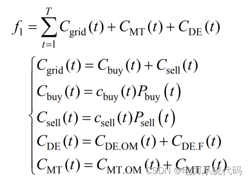
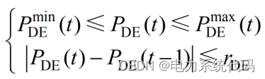
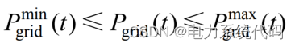
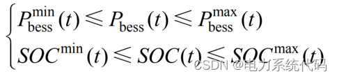
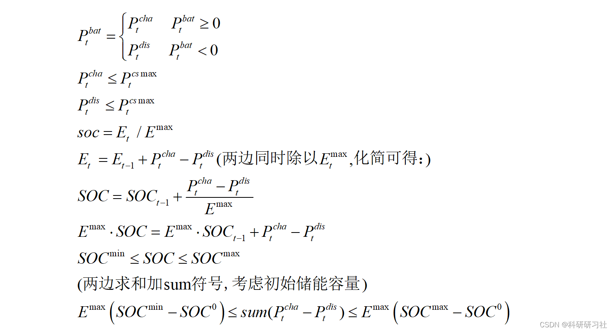
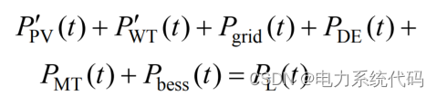
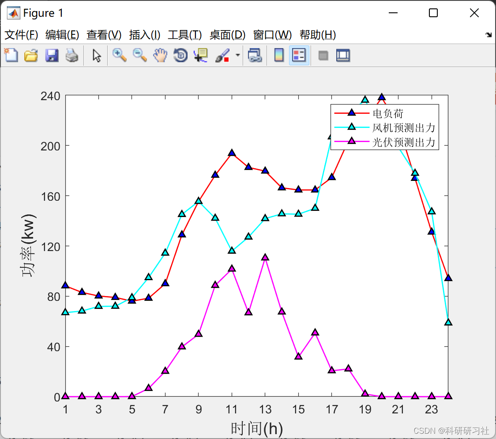
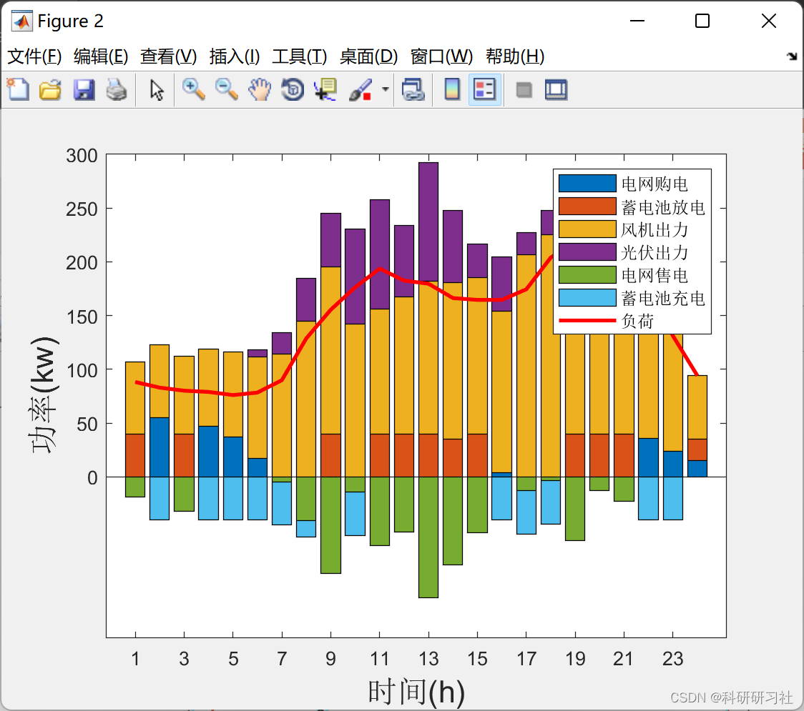
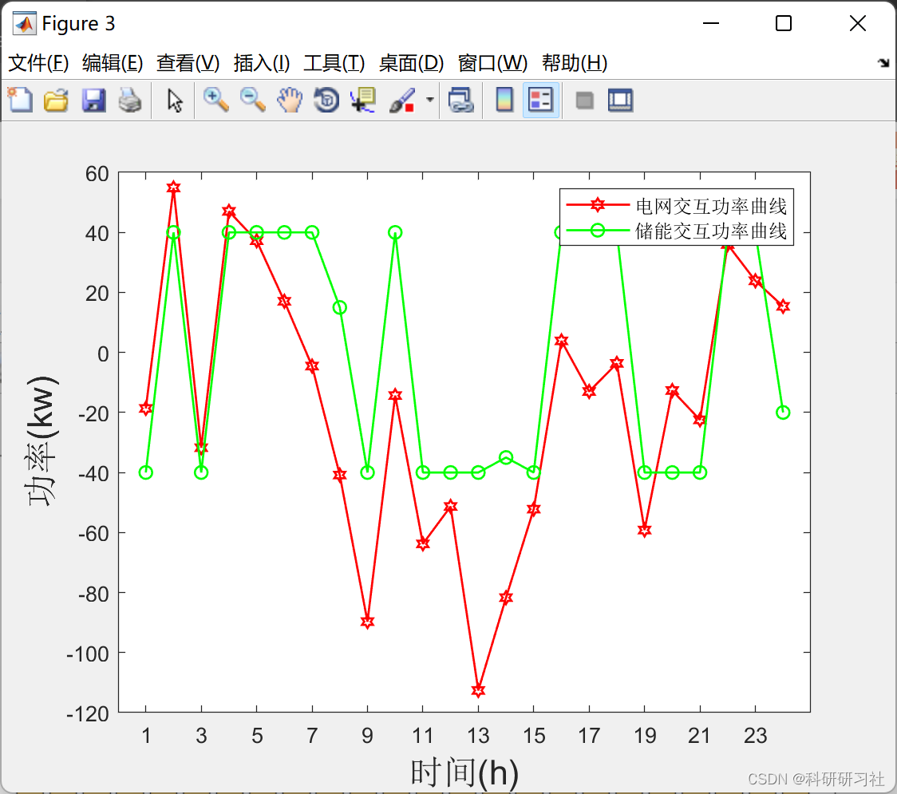
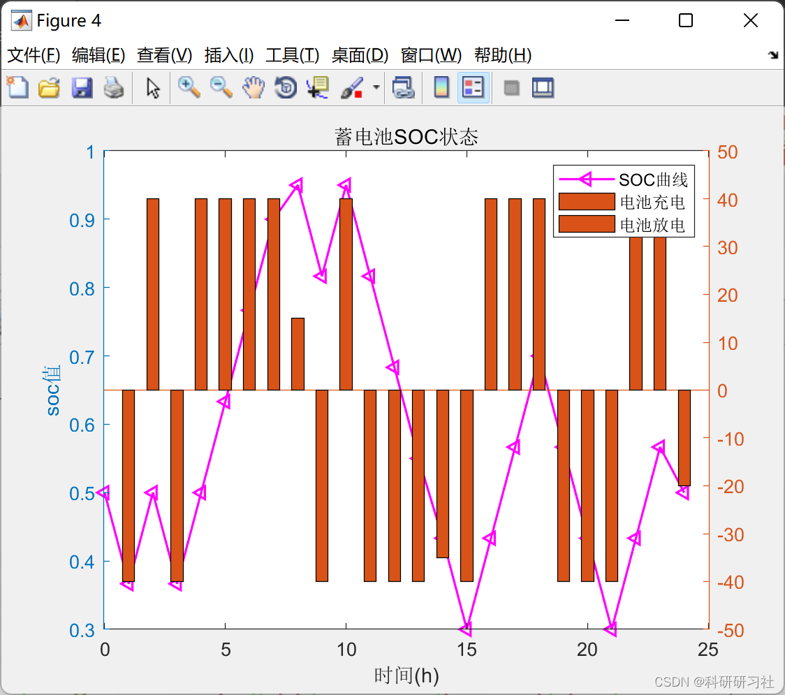

# Economic Dispatch of Microgrid (Wind, Solar Power, Energy Storage, Interaction with the Grid) (Matlab Code Implementation)

​  
Contents
0 Abstract
1 Microgrid Model
2. Objective Function of Economic Dispatch in Microgrids
3. Economic Dispatch of Microgrids: Constraints
3.1 Equipment Constraints
3.2 Power balance constraints
4 Yalmip+Cplex  
4.1 Download and Installation Tutorial
4.2 Yalmip  
4.3 Cplex  
5. MATLAB Code Implementation and Explanation
6 Running Results
7 References
8. Conclusion
The diesel engine requires modification according to the program, and the image is not shown. [Warm Reminder]0 Abstract: The optimization of microgrid dispatching as an important component of smart grid optimization plays a significant role in reducing energy consumption and environmental pollution. The development goals of microgrids should meet both the basic needs for power supply and enhance economic benefits and environmental protection. This paper solves the optimization dispatching problem of microgrids based on the Matlab platform, using Yalmip+Cplex. The process of solving the dispatching problem is relatively simple and convenient, with strong modifiability, making it suitable for beginners to quickly understand the use of Yalmip+Cplex and the principles of economic dispatching in microgrids.
1 Microgrid Model The microgrid model discussed in this paper includes: wind turbines, photovoltaic solar panels, grid power tie lines, diesel generators, energy storage batteries, and electrical load.
2. Objective Function of Microgrid Economic Dispatch
Wherein: Cgrid(t), Cbess(t), and CDE(t) represent the total costs of interaction between the microgrid and the main grid, the maintenance costs of energy storage, and the total operating costs of diesel generators respectively at time t; Pbess(t) represents the power of energy storage at time t; Psell(t) and Pbuy(t) represent the electricity sales and purchases power of the microgrid and the main grid respectively at time t; Cbuy(t) and Csell(t) represent the purchase and sale electricity prices of the microgrid and the main grid respectively at time t.
3. Economic Dispatch of Microgrids
Constraints mainly include two types: one is the constraints of the equipment itself, such as maximum power output and ramp constraints; the other is the network constraints like power balance.
3.1 Equipment Constraints for Diesel Generation Set: Mainly includes maximum and minimum output power constraints and ramp constraints.
Power Connection Line Constraints: Mainly includes maximum and minimum output power constraints.
Energy Storage Device Constraints: Mainly includes maximum and minimum output power constraints and capacity constraints. Additionally, after the dispatch of energy storage system in a day, it needs to return its SOC back to the initial value.
Edit
Edit
3.2 Power Balance Constraints
4 Yalmip+Cplex 4.1 Download and Installation Guide for Yalmip and Cplex (Matlab)
4.2 Yalmip can be understood as a toolkit that converts simple programming languages into different solvers for users to use the same language to call different solvers. Download and install Yalmip from the official website, unzip it to the Matlab Toolbox, then set the Path path, and you can use it. Yalmip is very convenient to use, just need to establish the model and set the parameters.
4.3 Cplex Cplex is a powerful commercial solver. When using Yalmip, all you need to do is set the solver to Cplex in the solve options to directly and quickly solve optimization problems without complex programming and solving steps. Use Yalmip to model, after modeling is completed, call the Cplex solver to solve, the whole process is very convenient.
5 Matlab Code Realization and Explanation: This article only displays part of the code, all codes and explanation click the link:
Microgrid Economic Dispatch (Wind, Solar, Diesel Engine, Battery Energy Storage, Interaction with the Grid)
%% Microgrid Economic Dispatch (Wind, Solar, Diesel Engine, Battery, Interaction with the Grid)\n%% Initialization\nclc;\nclear all;close all;\n\n%% Definition of variables and constants\n%------------------------Variable Definition-----------------------%\nPw=sdpvar(1,24,'full'); % Wind turbine output power\nPpv=sdpvar(1,24,'full');% Photovoltaic output power\nPbat=sdpvar(1,24,'full');% Battery power output\n%Pde=sdpvar(1,24,'full');% Diesel engine set output\nPnet=sdpvar(1,24,'full');%Exchange power\nPbuy=sdpvar(1,24,'full');% Purchase electricity from the electric grid\nPsell=sdpvar(1,24,'full');% Electricity sold to the grid\nTemp_net=binvar(1,24,'full'); % Purchase/Sale Electricity Flag\nTemp_cha=binvar(1,24,'full'); %Charging flag\nTemp_dis=binvar(1,24,'full'); % Discharge flag\nTemp_static=binvar(1,24,'full'); % Battery Standby Flag\n% Temp_de=binvar(1,24,'full'); % Diesel engine power generation flag\nPcha=sdpvar(1,24);\nPdis=sdpvar(1,24);\nConstraints = [];\n%-------------------------Constant Definition-----------------------%\nLoad=[88.24 \t83.01 \t80.15 \t79.01 \t76.07 \t78.39 \t89.95 \t128.85 \t155.45 \t176.35 \t193.71 \t182.57 \t179.64 \t166.31 \t164.61 \t164.61 \t174.48 \t203.93 \t218.99 \t238.11 \t216.14 \t173.87 \t131.07 \t94.04];\n% Wind turbine predicted output power\nPw=[66.9\t68.2\t71.9\t72\t78.8\t94.8\t114.3\t145.1\t155.5\t142.1\t115.9\t127.1\t141.8\t145.6...\n    145.3\t150\t206.9\t225.5\t236.1\t210.8\t198.6\t177.9\t147.2\t58.7];\n% Photovoltaic power forecasting\nPpv=[0\t0\t0\t0\t0.06\t6.54\t20.19\t39.61\t49.64\t88.62\t101.59\t66.78\t110.46\t67.41\t31.53...\n    50.76\t20.6\t22.08\t2.07\t0\t0\t0\t0\t0];\n% Time-of-use electricity price\nC_buy=[0.25\t0.25\t0.25\t0.25\t0.25\t0.25\t0.25\t0.53\t0.53\t0.53\t0.82\t0.82...\n    0.82\t0.82\t0.82\t0.53\t0.53\t0.53\t0.82\t0.82\t0.82\t0.53\t0.53\t0.53];\nC_sell=[0.22\t0.22\t0.22\t0.22\t0.22\t0.22\t0.22\t0.42\t0.42\t0.42\t0.65\t0.65...\n    0.65\t0.65\t0.65\t0.42\t0.42\t0.42\t0.65\t0.65\t0.65\t0.42\t0.42\t0.42];\n  
6 Running Results Editing
Editing
Editing
Editing
7 References [1] Yuan Huajun, Ye Xiaoyi, Geng Zongpu. Microgrid Dispatch Operation Considering Economic Cost[J]. Electrical Automation, 2021, 43(05):48-50.  
[2] Yu Hao. Research and Application of Economic Dispatch Strategy for AC/DC Mixed Microgrid[D]. Taiyuan University of Technology, 2020. DOI:10.27352/d.cnki.gylgu.2020.001543.

## Images

<!-- PAYMENT_BLOCK -->

## Get this dataset

- Payment link (Stripe): [Buy now](https://buy.stripe.com/3cs8yP7sY87d0vu9AB)
- Payment QR code: 

<!-- /PAYMENT_BLOCK -->
